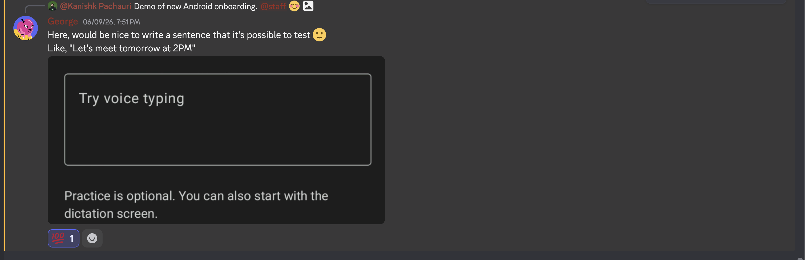
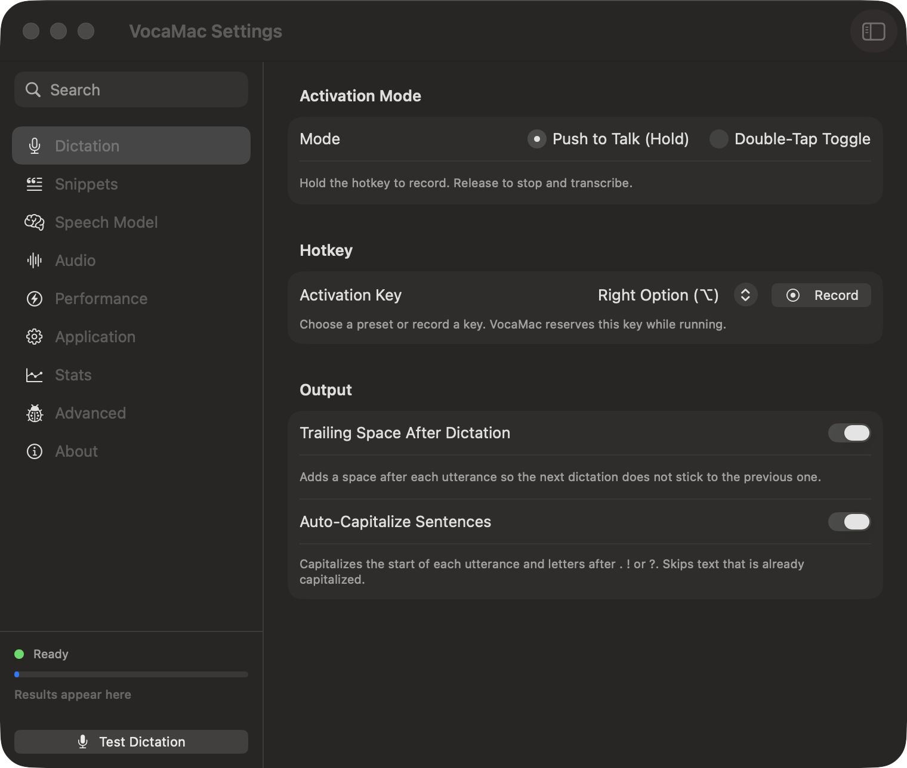
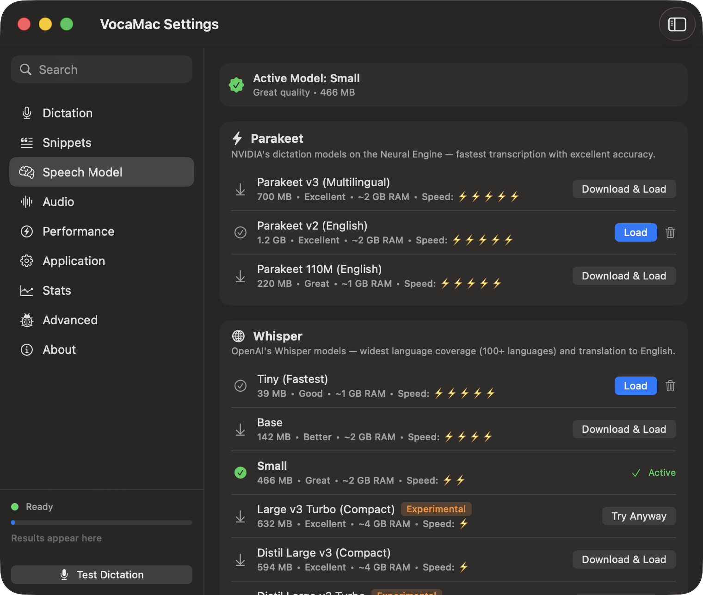
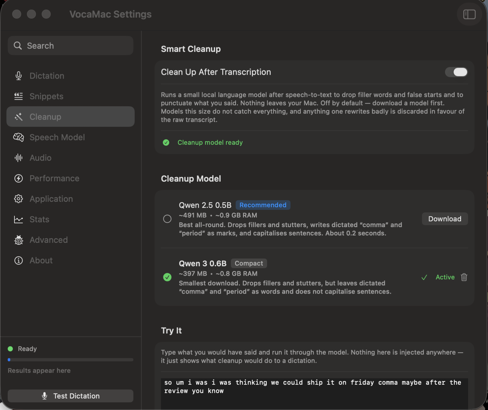

<p align="center">
  
</p>

<h1 align="center">VocaMac</h1>

<p align="center"><strong>Hold a key, speak, and your words appear wherever you type.</strong><br>
Open-source dictation for macOS. Your voice is transcribed on your Mac.</p>

<p align="center">
  <a href="https://github.com/VocaHQ/vocamac/releases/latest"></a>
  <a href="https://github.com/VocaHQ/vocamac/actions/workflows/ci.yml"></a>
  <a href="https://scorecard.dev/viewer/?uri=github.com/VocaHQ/vocamac"></a>
  <a href="https://www.gnu.org/licenses/agpl-3.0"></a>
  <a href="https://discord.gg/t6muquAJbm"></a>
</p>

<p align="center">
  <a href="https://github.com/VocaHQ/vocamac/releases/latest"><strong>Download</strong></a> ·
  <a href="https://vocamac.com">Website</a> ·
  <a href="docs/MODELS.md">Models</a> ·
  <a href="https://discord.gg/t6muquAJbm">Discord</a>
</p>

<p align="center">
  
</p>

## Why VocaMac

- **Private.** Speech is recognized on your Mac. No account, no subscription, no cloud speech service.
- **Works everywhere.** Text is typed at your cursor in any app: Mail, Slack, VS Code, the terminal, your browser.
- **Fast and accurate.** Native Apple Silicon engines (Parakeet, Whisper, Apple Speech) on the Neural Engine and GPU.
- **Free and open source** under AGPL-3.0.

## Install

Needs an Apple Silicon Mac on macOS 14 Sonoma or later.

```bash
brew tap vocahq/vocamac
brew trust vocahq/vocamac
brew install --cask vocamac
```

Or download the DMG from the [latest release](https://github.com/VocaHQ/vocamac/releases/latest) and drag VocaMac to Applications. The app is signed and notarized by Apple.

[Nightly builds, building from source, and uninstalling →](docs/INSTALL.md)

## Get started

1. Open VocaMac. It lives in the menu bar, not the Dock.
2. Allow the three permissions it asks for:

   | Permission | Why |
   |---|---|
   | Microphone | To hear you |
   | Accessibility | To type the text into other apps |
   | Input Monitoring | To notice the shortcut in any app (VocaMac asks to reopen once after you allow it) |

3. Hold **Right Option**, speak, and let go. Your words appear at the cursor.

You can also double-tap the key to start and stop, use a separate hands-free shortcut or a mouse button, and press **Escape** to cancel. Change the shortcut in **Settings → Dictation**.

The Tiny Whisper model is built in, so you can dictate right away. VocaMac suggests a better model for your Mac, which downloads once.

## Features

**Dictation**
- Type into any app, with live words in a small overlay while you speak.
- Paragraph breaks at long pauses between sentences, and spoken emoji and numbers ("party emoji" → 🎉, "seven thirty pm" → 7:30 pm).
- Personal dictionary for names and jargon ("get hub" → GitHub), plus snippets that expand short phrases.
- History of past dictations to search, replay, and paste again (⌃⌘V). You can keep chosen apps out of it, or turn it off.

**Writing**
- Writing styles per app or website: email, chat, notes, code, terminal.
- Cleanup removes "um", false starts, and changes of mind ("let's meet tomorrow, sorry, no, let's meet Friday" → "let's meet Friday", "scratch that") with on-device rules, and a small on-device model tidies the rest.
- Command Mode: select text and say what to change ("make this shorter", "translate to Spanish").

**And more**
- Transcribe audio and video files, or record system audio.
- A [command-line transcriber](docs/CLI.md) for scripts.
- Automation with the Shortcuts app and `vocamac://` links.
- Installs its own updates and keeps your permissions.

See every feature on [vocamac.com](https://vocamac.com).

## Privacy

Local speech engines process audio on your Mac. After a model is downloaded, dictation works offline, and nothing about what you say leaves the computer.

Two features can send data elsewhere, and both are off until you set them up:

- **Custom Endpoint** uploads each recording to a speech server that *you* host.
- **Remote cleanup** (Ollama, LM Studio, or an OpenAI-compatible endpoint) sends text to clean up or edit, never audio. API keys stay in your Keychain.

## Speech models

| Engine | Best for | Runs on |
|---|---|---|
| **Parakeet** (recommended) | Fastest dictation, in English or 25 European languages | Neural Engine |
| **Whisper** | The most languages, and translation to English | Neural Engine and GPU |
| **Apple Speech** | Built into macOS 26 and later; language packs may download on first use | On device, managed by macOS |
| **Specialized** (Moonshine, SenseVoice, GigaAM, Canary, Qwen3 ASR, Cohere Transcribe) | Low-memory Macs; Chinese, Japanese, Korean, or Russian; or the highest accuracy in one of Cohere's 14 languages | CPU |

Sizes, languages, and the full list are in [docs/MODELS.md](docs/MODELS.md).

## Screenshots

<details>
<summary>Show screenshots</summary>
<br>

| | |
|---|---|
|  |  |
| Dictation | Speech Model |
|  |  |
| Writing Styles | Dictionary |
|  |  |
| Smart Cleanup | History |
|  |  |
| Recording indicator | In-app update |

</details>

## Documentation

| | |
|---|---|
| [Install](docs/INSTALL.md) | Homebrew, DMG, nightly builds, building from source, uninstalling |
| [Speech models](docs/MODELS.md) | Every engine and model, with sizes and languages |
| [Command-line transcription](docs/CLI.md) | Transcribe files from scripts, with JSON output |
| [Troubleshooting](docs/TROUBLESHOOTING.md) | Resetting permissions or settings, update errors |
| [Managed Macs](https://vocamac.com/enterprise/) | Pre-approving permissions with MDM |
| [Architecture](docs/ARCHITECTURE.md) | How the app is built |

## The Voca family

VocaMac is the macOS member of [Voca](https://vocahq.com).

| Platform | Project | Status |
|---|---|---|
| macOS | [VocaMac](https://github.com/VocaHQ/vocamac) | Stable (`v1.2.0`) |
| Linux | [VocaLinux](https://github.com/VocaHQ/vocalinux) | Available now (`v0.16.0`) |
| Windows | [VocaWin](https://github.com/VocaHQ/vocawin) | Beta (unsigned `v0.1.0-beta.1`) |
| Phone | [VocaPhone](https://github.com/VocaHQ/vocaphone) | Android beta, iOS [TestFlight](https://testflight.apple.com/join/wd85wQ3W) |
| Gateway | [VocaGateway](https://github.com/VocaHQ/vocagateway) | Early. Optional self-hosted compute, not on-device |

## Contributing

Bug reports, ideas, and pull requests are welcome. Start with [CONTRIBUTING.md](CONTRIBUTING.md), or say hi on [Discord](https://discord.gg/t6muquAJbm).

VocaMac is built on [WhisperKit](https://github.com/argmaxinc/argmax-oss-swift), [FluidAudio](https://github.com/FluidInference/FluidAudio), [sherpa-onnx](https://github.com/k2-fsa/sherpa-onnx), and [LLM.swift](https://github.com/eastriverlee/LLM.swift).

## License

[AGPL-3.0](LICENSE)

## Star History

<a href="https://www.star-history.com/?repos=VocaHQ%2Fvocamac&type=date&legend=top-left">
 <picture>
   <source media="(prefers-color-scheme: dark)" srcset="https://api.star-history.com/chart?repos=VocaHQ/vocamac&type=date&theme=dark&legend=top-left&sealed_token=otfG_PjqVtfSDqjuVxBihRMsoeuZwc0ZnUdPqNX9TypLSfyjI0QHWwkE-IVtel80QH3TtIRZzDSNYISJ_tYCHQjqN5fWBUY028tmOiUPvH_MIJroI3Kidg" />
   <source media="(prefers-color-scheme: light)" srcset="https://api.star-history.com/chart?repos=VocaHQ/vocamac&type=date&legend=top-left&sealed_token=otfG_PjqVtfSDqjuVxBihRMsoeuZwc0ZnUdPqNX9TypLSfyjI0QHWwkE-IVtel80QH3TtIRZzDSNYISJ_tYCHQjqN5fWBUY028tmOiUPvH_MIJroI3Kidg" />
   
 </picture>
</a>

<p align="center">Made for the macOS community · <a href="https://x.com/vocahq">@vocahq on X</a> · <a href="mailto:hello@vocahq.com">hello@vocahq.com</a></p>
